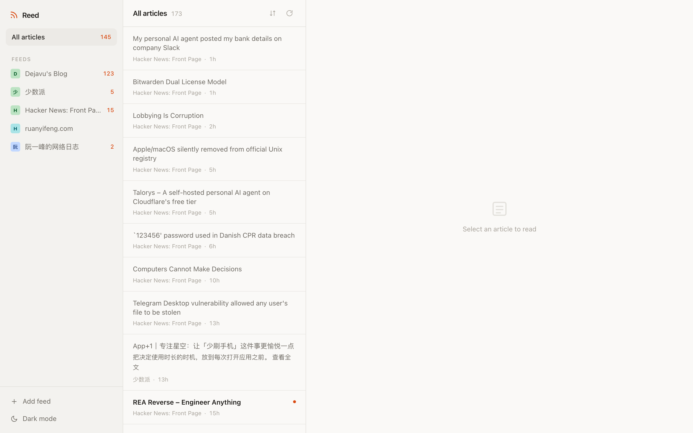

# Reed

<p>
  
</p>

A personal RSS reader built on Vercel (Hono), Turso (libSQL/SQLite), and GitHub Actions — static assets and API in one deployment, scheduled refresh in CI.



---

## Features

- Add RSS 2.0 and Atom feeds by URL
- Hourly background refresh via GitHub Actions; manual refresh-all or per-feed
- Read/unread tracking, auto-mark-read on open
- Sort articles newest or oldest first
- Markdown and HTML article content rendering
- Article titles link to original posts
- Dark/light mode toggle (defaults to light mode)
- Resizable three-pane layout: feed sidebar, article list, article reader
- REST API is fully `curl`-able — no auth in phase 1

---

## Stack

| Layer | Technology |
|-------|-----------|
| Runtime | Vercel serverless functions (Node) |
| Database | Turso (libSQL/SQLite) |
| Scheduled refresh | GitHub Actions cron |
| ORM | Drizzle ORM + drizzle-kit |
| HTTP router | Hono |
| RSS parsing | fast-xml-parser |
| Frontend | React 19 + Vite |
| UI | @cloudflare/kumo + Tailwind v4 |
| Monorepo | pnpm workspaces |
| Linting | Biome |
| Testing | Vitest |

---

## Project structure

```
reed/
├── api/            # Vercel serverless entry (Hono via hono/vercel)
├── .github/        # workflows/refresh.yml — hourly feed refresh
├── packages/
│   ├── types/      # @reed/types  — shared TypeScript types
│   ├── worker/     # @reed/worker — REST API + Turso + refresh scripts
│   └── app/        # @reed/app    — React SPA
├── vercel.json     # Build config + SPA fallback
├── AGENTS.md       # Architecture reference for agents and contributors
└── WORKLOG.md      # Decision log for every increment
```

---

## REST API

| Method | Path | Description |
|--------|------|-------------|
| `GET` | `/api/feeds` | List all feeds |
| `POST` | `/api/feeds` | Add a feed `{ url }` |
| `DELETE` | `/api/feeds/:id` | Delete a feed and its articles |
| `POST` | `/api/feeds/:id/refresh` | Manually refresh a feed |
| `GET` | `/api/articles` | List articles (`?feed_id=`, `?unread=true`) |
| `PATCH` | `/api/articles/:id` | Mark read/unread `{ read: boolean }` |

All responses are JSON. Errors return `{ error: string }`.

---

## Development

```bash
# Install dependencies
pnpm install

# Initialise a local SQLite file DB with the schema (one-time)
TURSO_DATABASE_URL=file:local.db pnpm --filter @reed/worker db:local

# Run the API locally on :8787
TURSO_DATABASE_URL=file:local.db pnpm dev

# Run the frontend dev server (proxies /api/* to :8787)
pnpm --filter @reed/app dev

# Run all tests
pnpm test:run

# Type-check all packages
pnpm type-check
```

---

## Deployment

```bash
# First time: import the repo in Vercel, set TURSO_DATABASE_URL /
# TURSO_AUTH_TOKEN project env vars, bind a custom domain.

# Deploy from the CLI (or just push — Vercel builds from the repo)
pnpm deploy
```

Schema migrations are applied directly to Turso:

```bash
export TURSO_DATABASE_URL=libsql://...
export TURSO_AUTH_TOKEN=...
pnpm --filter @reed/worker db:migrate
```

The hourly refresh workflow (`.github/workflows/refresh.yml`) needs the
`TURSO_DATABASE_URL` and `TURSO_AUTH_TOKEN` repository secrets.

---

## Schema changes

```bash
# Edit packages/worker/src/db/schema.ts, then:
pnpm --filter @reed/worker db:generate   # generates SQL in drizzle/
pnpm --filter @reed/worker db:migrate    # apply to Turso (TURSO_* env vars)
```

---

## Pre-commit hooks

Every commit runs:
1. Biome lint + format on staged files
2. `tsc --noEmit` across all packages
3. `vitest run` across all packages

---

## Roadmap

- **Phase 3:** auth, CLI tool, full-text search (FTS5), OPML import/export
